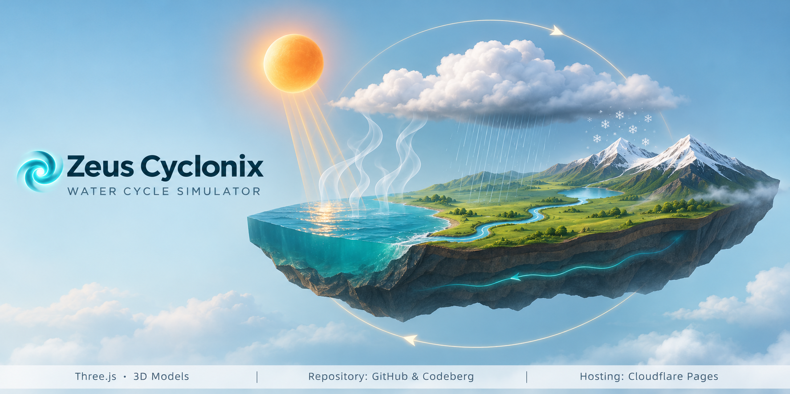

  

<h1 align="center">🌀 Zeus Cyclonix</h1>

<em>Interactive 3D Water Cycle Simulator</em>

<a href="https://zeus-cyclonix.stark-kodex.workers.dev/"><strong>Enter the Vortex 🌀</strong></a>

  <a href="#-about">About</a> ·
  <a href="#-screenshots">Screenshots</a> ·
  <a href="#-the-three-processes">Processes</a> ·
  <a href="#-controls">Controls</a> ·
  <a href="#-inside-a-cloud">Cloud magnifier</a> ·
  <a href="#-teach-mode">Teach mode</a> ·
  <a href="#-science-behind-it">Science</a> ·
  <a href="#-technology">Technology</a> ·
  <a href="#-3d-models">3D Models</a> ·
  <a href="#-credits">Credits</a>

---

## 📖 About

A 3D landscape that shows younger learners how water moves around the Earth. Real animated 3D models bring the sea, clouds, rain, snow, plants and rivers to life, so students can see:

- **where the water goes**: from the sea and plants up into the air, into clouds, and back down as rain or snow
- **why clouds form** and why it snows on the peaks but rains on the plains
- **that water is never used up**: it only changes state and place

Made for lower classes and built for classroom smart panels; it works on laptops and phones too.

---

## 📸 Screenshots

<table width="100%">
  <tr>
    <td width="50%" align="center">
      
       <b>Interactive Water Cycle Simulator</b>
    </td>
    <td width="50%" align="center">
      
       <b>Explore the Cloud · Condensation</b>
    </td>
  </tr>
  <tr>
    <td width="50%" align="center">
      
       <b>Runoff &amp; Seepage</b>
    </td>
    <td width="50%" align="center">
      
       <b>Crafted with Three.js</b>
    </td>
  </tr>
</table>

---

## 🌀 The Three Processes

Three numbered chips on the left show each process as it happens, with a live meter.

| | Process | What you see |
|:-:|:--|:--|
| **1** | **Evaporation** | The Sun warms the sea and lake, and plants transpire. Water escapes as invisible vapour, drawn as faint mist, and rises. A brighter Sun means faster evaporation. |
| **2** | **Condensation** | The rising air cools to its dew point. Vapour turns into droplets and clouds grow. Tap a cloud to look inside it. |
| **3** | **Precipitation** | Drops grow too heavy and fall: rain on the plains, snow on the peaks. The water then runs off to the sea and soaks into the ground as groundwater. |

The landscape also shows plants by vegetation zone (maize, grass, clover, wildflowers, tree groves, ferns and forest) swaying with the wind, sea mist near saturation, and ripples where rain meets water.

---

## 🧭 Controls

| Control | What it does |
|:--|:--|
| Drag · pinch or scroll | Rotate · zoom the 3D scene |
| Tap a cloud | Look inside it |
| ☀️ **Sun's heat** slider | Air temperature from 10 to 45 °C; a hotter Sun gives stronger rays and faster evaporation |
| 💧 **Humidity** slider | Relative humidity from 20 to 95% |
| 🌬️ **Wind** slider | Wind speed from 0 to 12 m/s; plants sway with it |
| ⏯ Play / Pause | Pause or resume; tap the sky or press Space for the same |
| **1×** | Cycles the simulation speed through ½×, 1×, 2× and 4× |
| Labels · Sun's rays · Cycle arrows | Show or hide each layer |
| ↺ Clear sky & restart | Starts again with a clear sky |
| **Whole cycle** | Pulls the view back to the whole cycle |
| **Teach mode** | A guided, one-stage-at-a-time lesson |
| ⛶ Full screen | Fills the screen where the device allows it |
| © | Opens the credits |

---

## 📊 The Data Panel

Open the **Data** tab for the numbers behind the scene. They are calculated live from the sliders.

| Reading | Meaning |
|:--|:--|
| Dew point · Cloud base height · Rising air at cloud base | Where and why the clouds form |
| Over the plains · Over the peaks | Whether it rains or snows in each place |
| Water budget | How much has evaporated and transpired, is rising as vapour, is held in clouds, and has fallen as rain or snow |
| Altitude thermometer | Shows that the surrounding air gets colder with height |

The scene's heights are not to scale.

---

## 🔍 Inside a Cloud

Tap a cloud to open the **cloud magnifier**, with 3D water molecules:

- **Warm cloud:** vapour molecules move freely, the air cools to its dew point, molecules collect on a salt crystal and form a droplet, and droplets join into a raindrop. Inside the droplet you can see the structure of liquid water.
- **Freezing cloud:** below 0 °C, molecules settle on a dust grain and lock into a hexagonal ice lattice. The crystal grows into a snowflake that falls as snow.

The magnifier is marked "Not to scale".

---

## 🎓 Teach Mode

Press **Teach mode** for three short stages, one at a time. Press **Next** to move on and **Finish** to let the whole cycle run on its own.

1. **Evaporation:** the Sun warms the sea and water escapes as invisible vapour.
2. **Condensation:** the air cools to its dew point and the vapour forms droplets.
3. **Precipitation:** drops fall, run off to the sea and soak into the ground.

---

## 🔬 Science Behind It

| Idea | Used for |
|:--|:--|
| Dalton's law | Evaporation from temperature, humidity and wind |
| Magnus formula | Dew point |
| Cloud base ≈ 125 m for each 1 °C gap between air temperature and dew point | Cloud base height |
| Rising air cools about 10 °C/km; surrounding air about 6.5 °C/km | Altitude thermometer and snow on the peaks |
| Ice Ih | Hexagonal lattice, O–O distance 2.76 Å, four hydrogen bonds per molecule |
| Bergeron process | Snowflake growth |

---

## 💻 Technology

HTML · CSS · JavaScript · Three.js · Cloudflare Pages

Repository: GitHub & Codeberg

---

## 🧩 3D Models

All models are from [Sketchfab](https://sketchfab.com). 🎞️ marks the three animated models.

| | Asset | Model | Creator | Licence |
|:-:|:--|:--|:--|:--|
| 🏞️🎞️ | Landscape | [Water Cycle (Animated)](https://sketchfab.com/3d-models/water-cycle-animated-203e16058fa94e618829447db71ddba4) | RODX81, shared by Clement Abai | CC BY 4.0 |
| ☀️ | Sun | [Sun with 2K Textures](https://sketchfab.com/3d-models/sun-with-2k-textures-bac9e8f95040484bb86f1deb9bd6fe95) | ayushcodemate | See source |
| ☁️ | Clouds | [Fluffy Cloud](https://sketchfab.com/3d-models/fluffy-cloud-2c887a28840f47cfae6b5dee0d11b842) | [Loïc Norgeot](https://sketchfab.com/norgeotloic) | CC BY 4.0 |
| ❄️🎞️ | Snow | [Looping Snow 2](https://sketchfab.com/3d-models/looping-snow-2-939d059c7a43424f93c3e8e44e1d5489) | [Elin](https://sketchfab.com/ElinHohler) | CC BY 4.0 |
| 💧 | Raindrops | [drop of water](https://sketchfab.com/3d-models/drop-of-water-dcbdc5e8905449ad95a47720e4d3c57c) | [furret](https://sketchfab.com/ff.ferretti02) | CC BY 4.0 |
| 🌊🎞️ | Sea and river | [Water Animation](https://sketchfab.com/3d-models/water-animation-e54ff76bef854b128af8d20cf9c03729) | [Artise1](https://sketchfab.com/Artise1) | CC BY 4.0 |
| ⚛️ | Water molecule | [H2O Molecule](https://sketchfab.com/3d-models/h2o-molecule-e181944932084b5dbb4d5b625a5e9b10) | [Mehdi Mirzaie](https://sketchfab.com/MehdiMM) | CC BY 4.0 |
| 💠 | Liquid water | [Structure of liquid water](https://sketchfab.com/3d-models/structure-of-liquid-water-bbf17bb125f440d5ab2c71af13e5e6eb) | [Justus Mutanen](https://sketchfab.com/justusmutanen) | CC BY 4.0 |
| 🌽 | Maize | [Plant](https://sketchfab.com/3d-models/plant-e94595cf83e74b509fc5b2eac092b4bb) | [SomeKevin](https://sketchfab.com/SomeKevin) | CC BY 4.0 |
| 🌳 | Trees, grass tufts | [Low Poly Tree Scene Free](https://sketchfab.com/3d-models/low-poly-tree-scene-free-89daa5e21f0d4f08a59dba0d566e88bd) | [Nicholas-3D](https://sketchfab.com/Nicholas01) | CC BY 4.0 |
| 🍀 | Clover | [Clovers - Plants / Foliage](https://sketchfab.com/3d-models/clovers-plants-foliage-d68dc45e329e48e3bc83ecc5448a6c25) | [Studio Lab](https://sketchfab.com/studiolab.dev) | CC BY 4.0 |
| 🌿 | Ferns, wildflowers | [Plants Asset Set](https://sketchfab.com/3d-models/plants-asset-set-2edf52774f4d4cde8d8c3a19b8dda205) | [Em Marshall](https://sketchfab.com/emarshall) | CC BY 4.0 |

Licence for the CC BY 4.0 models: [creativecommons.org/licenses/by/4.0](https://creativecommons.org/licenses/by/4.0/). Original creators retain ownership of their models.

**Changes made:** the models were compressed, resized and re-coloured for this simulator. The landscape's magma layer is repainted as rock, and its own sun, clouds and raindrops are replaced by the models above. The cloud uses fewer layers. The water molecule is recoloured to the standard CPK colours (oxygen red, hydrogen white), and the ice lattice in a freezing cloud is built from it.

---

## 🙏 Credits

| Role | Credit |
|:--|:--|
| 👤 Project Designer | **Sai Prasad**, Msc. Ag. Entomology, NET |
| 🤖 Development | Claude Opus 5.5 (AI-assisted development) |

**Libraries and assets**

| Component | Licence |
|:--|:--|
| Three.js | MIT |
| IBM Plex fonts | SIL Open Font License |
| Material Symbols icons (Google) | Apache 2.0 |

---

## 📝 Changelog

Version history, RC I to RC X: [CHANGELOG.md](CHANGELOG.md)

---

## 📜 License

Original source code: **GNU GPL-3.0** (see [LICENSE](LICENSE)). Third-party assets keep their own licences.

---

  <b>Repository</b>: GitHub · Codeberg &nbsp;&nbsp;|&nbsp;&nbsp; <b>Hosting</b>: Cloudflare Pages

