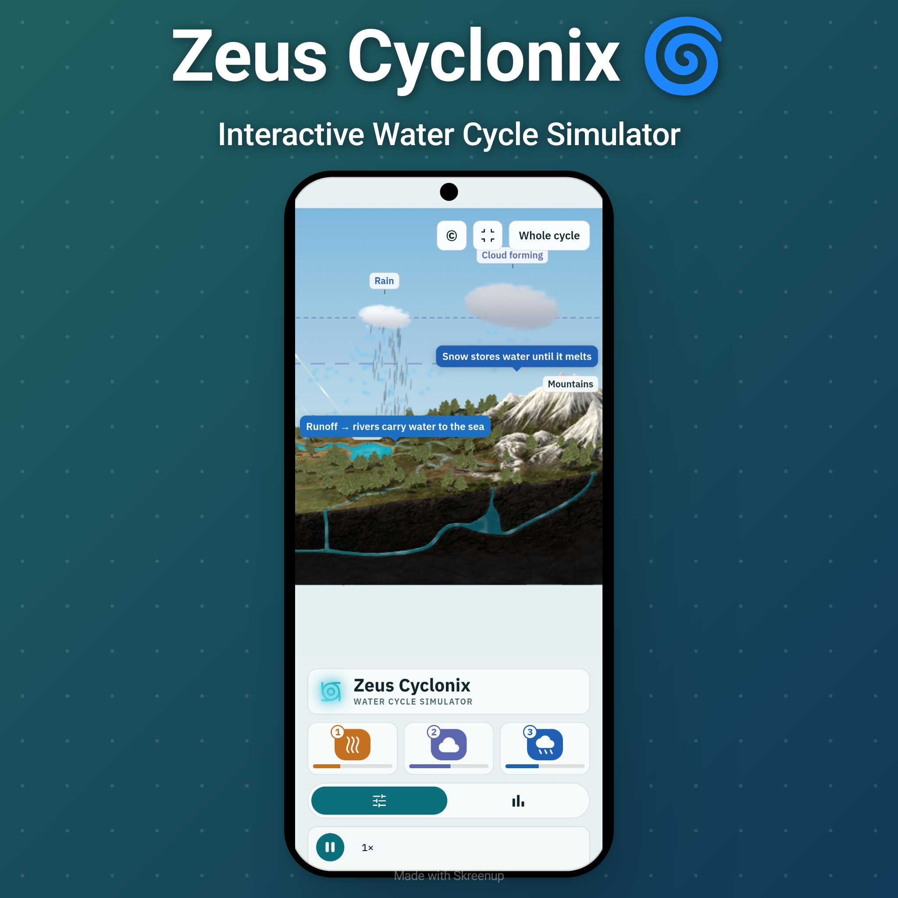

  

<h1 align="center">Zeus Cyclonix</h1>

<em>Interactive 3D Water Cycle Simulator</em>

<a href="https://zeus-cyclonix.stark-kodex.workers.dev/"><strong>Launch the Simulator</strong></a>

  <a href="#about">About</a> ·
  <a href="#screenshots">Screenshots</a> ·
  <a href="#the-three-processes">Processes</a> ·
  <a href="#controls">Controls</a> ·
  <a href="#data-panel">Data Panel</a> ·
  <a href="#inside-a-cloud">Inside a Cloud</a> ·
  <a href="#teach-mode">Teach Mode</a> ·
  <a href="#science">Science</a> ·
  <a href="#technology">Technology</a> ·
  <a href="#3d-models">3D Models</a> ·
  <a href="#credits">Credits</a> ·
  <a href="#releases">Releases</a> ·
  <a href="#license">License</a>

---

## About

Zeus Cyclonix is a 3D landscape that shows younger learners how water moves around the Earth. Animated 3D models of the sea, clouds, rain, snow, plants and rivers let students see:

- **Where the water goes:** from the sea and plants into the air, into clouds, and back down as rain or snow
- **Why clouds form**, and why it snows on the peaks but rains on the plains
- **That water is never used up:** it only changes state and place

Built for classroom smart panels; also runs on laptops and phones.

---

## Screenshots

<table width="100%">
  <tr>
    <td width="50%" align="center">
      
       <b>Interactive Water Cycle Simulator</b>
    </td>
    <td width="50%" align="center">
      
       <b>Explore the Cloud · Condensation</b>
    </td>
  </tr>
  <tr>
    <td width="50%" align="center">
      
       <b>Runoff and Seepage</b>
    </td>
    <td width="50%" align="center">
      
       <b>Built with Three.js</b>
    </td>
  </tr>
</table>

---

## The Three Processes

Three numbered chips on the left track each process with a live meter.

| Stage | Process | What Happens |
|:-:|:--|:--|
| 1 | **Evaporation** | The Sun warms the sea and lake, and plants transpire. Water escapes as invisible vapour, drawn as faint mist. A stronger Sun means faster evaporation. |
| 2 | **Condensation** | Rising air cools to its dew point. Vapour turns into droplets and clouds grow. Tap a cloud to look inside. |
| 3 | **Precipitation** | Drops grow heavy and fall: rain on the plains, snow on the peaks. Water runs off to the sea and soaks into the ground as groundwater. |

The landscape also shows vegetation zones (maize, grass, clover, wildflowers, tree groves, ferns and forest) swaying with the wind, sea mist near saturation, and ripples where rain meets water.

---

## Controls

| Control | Function |
|:--|:--|
| Drag · Pinch or scroll | Rotate · Zoom the scene |
| Tap a cloud | Open the cloud magnifier |
| Sun's Heat slider | Air temperature, 10–45 °C; stronger rays and faster evaporation |
| Humidity slider | Relative humidity, 20–95% |
| Wind slider | Wind speed, 0–12 m/s; plants sway with it |
| Play / Pause | Pause or resume; tap the sky or press Space |
| Speed (1×) | Cycles through ½×, 1×, 2× and 4× |
| Labels · Sun's Rays · Cycle Arrows | Show or hide each layer |
| Clear Sky and Restart | Restart with a clear sky |
| Whole Cycle | Pull the view back to the full cycle |
| Teach Mode | Guided, one-stage-at-a-time lesson |
| Full Screen | Fill the screen where supported |
| Credits (©) | Open the credits panel |

---

## Data Panel

The **Data** tab shows the numbers behind the scene, calculated live from the sliders.

| Reading | Meaning |
|:--|:--|
| Dew point · Cloud base height · Rising air at cloud base | Where and why clouds form |
| Over the plains · Over the peaks | Whether it rains or snows in each place |
| Water budget | Water evaporated and transpired, rising as vapour, held in clouds, and fallen as rain or snow |
| Altitude thermometer | Surrounding air gets colder with height |

Scene heights are not to scale.

---

## Inside a Cloud

Tap a cloud to open the **cloud magnifier**, built from 3D water molecules.

| Cloud Type | What You See |
|:--|:--|
| Warm cloud | Vapour molecules move freely, the air cools to its dew point, molecules collect on a salt crystal to form a droplet, and droplets join into a raindrop. The droplet shows the structure of liquid water. |
| Freezing cloud | Below 0 °C, molecules settle on a dust grain and lock into a hexagonal ice lattice. The crystal grows into a snowflake that falls as snow. |

The magnifier is marked "Not to scale".

---

## Teach Mode

Three short stages, one at a time. Press **Next** to advance and **Finish** to let the full cycle run.

| Stage | Lesson |
|:-:|:--|
| 1 | **Evaporation:** the Sun warms the sea and water escapes as invisible vapour |
| 2 | **Condensation:** the air cools to its dew point and vapour forms droplets |
| 3 | **Precipitation:** drops fall, run off to the sea and soak into the ground |

---

## Science

| Principle | Used For |
|:--|:--|
| Dalton's law | Evaporation from temperature, humidity and wind |
| Magnus formula | Dew point |
| ~125 m per 1 °C gap between air temperature and dew point | Cloud base height |
| Rising air cools ~10 °C/km; surrounding air ~6.5 °C/km | Altitude thermometer and snow on the peaks |
| Ice Ih | Hexagonal lattice, O–O distance 2.76 Å, four hydrogen bonds per molecule |
| Bergeron process | Snowflake growth |

---

## Technology

| Layer | Tool |
|:--|:--|
| Structure | `index.html` |
| Styling | `style.css` |
| Logic | `script.js` (ES module) |
| 3D engine | Three.js, bundled in `lib/three` |
| Typeface | IBM Plex Sans and Mono, bundled in `fonts/` |
| Models | GLB, in `models/` |
| Hosting | Cloudflare Pages |
| Repository | GitHub, mirrored to Codeberg |

---

## 3D Models

All models are from [Sketchfab](https://sketchfab.com). Animated models are marked *(animated)*.

| Asset | Model | Creator | Licence |
|:--|:--|:--|:--|
| Landscape *(animated)* | [Water Cycle (Animated)](https://sketchfab.com/3d-models/water-cycle-animated-203e16058fa94e618829447db71ddba4) | RODX81, shared by Clement Abai | CC BY 4.0 |
| Sun | [Sun with 2K Textures](https://sketchfab.com/3d-models/sun-with-2k-textures-bac9e8f95040484bb86f1deb9bd6fe95) | ayushcodemate | See source |
| Clouds | [Fluffy Cloud](https://sketchfab.com/3d-models/fluffy-cloud-2c887a28840f47cfae6b5dee0d11b842) | [Loïc Norgeot](https://sketchfab.com/norgeotloic) | CC BY 4.0 |
| Snow *(animated)* | [Looping Snow 2](https://sketchfab.com/3d-models/looping-snow-2-939d059c7a43424f93c3e8e44e1d5489) | [Elin](https://sketchfab.com/ElinHohler) | CC BY 4.0 |
| Raindrops | [drop of water](https://sketchfab.com/3d-models/drop-of-water-dcbdc5e8905449ad95a47720e4d3c57c) | [furret](https://sketchfab.com/ff.ferretti02) | CC BY 4.0 |
| Sea and river *(animated)* | [Water Animation](https://sketchfab.com/3d-models/water-animation-e54ff76bef854b128af8d20cf9c03729) | [Artise1](https://sketchfab.com/Artise1) | CC BY 4.0 |
| Water molecule | [H2O Molecule](https://sketchfab.com/3d-models/h2o-molecule-e181944932084b5dbb4d5b625a5e9b10) | [Mehdi Mirzaie](https://sketchfab.com/MehdiMM) | CC BY 4.0 |
| Liquid water | [Structure of liquid water](https://sketchfab.com/3d-models/structure-of-liquid-water-bbf17bb125f440d5ab2c71af13e5e6eb) | [Justus Mutanen](https://sketchfab.com/justusmutanen) | CC BY 4.0 |
| Maize | [Plant](https://sketchfab.com/3d-models/plant-e94595cf83e74b509fc5b2eac092b4bb) | [SomeKevin](https://sketchfab.com/SomeKevin) | CC BY 4.0 |
| Trees, grass tufts | [Low Poly Tree Scene Free](https://sketchfab.com/3d-models/low-poly-tree-scene-free-89daa5e21f0d4f08a59dba0d566e88bd) | [Nicholas-3D](https://sketchfab.com/Nicholas01) | CC BY 4.0 |
| Clover | [Clovers - Plants / Foliage](https://sketchfab.com/3d-models/clovers-plants-foliage-d68dc45e329e48e3bc83ecc5448a6c25) | [Studio Lab](https://sketchfab.com/studiolab.dev) | CC BY 4.0 |
| Ferns, wildflowers | [Plants Asset Set](https://sketchfab.com/3d-models/plants-asset-set-2edf52774f4d4cde8d8c3a19b8dda205) | [Em Marshall](https://sketchfab.com/emarshall) | CC BY 4.0 |

CC BY 4.0: [creativecommons.org/licenses/by/4.0](https://creativecommons.org/licenses/by/4.0/). Original creators retain ownership of their models.

**Modifications:** models were compressed, resized and recoloured for this simulator. The landscape's magma layer is repainted as rock, and its built-in sun, clouds and raindrops are replaced by the models above. The cloud uses fewer layers. The water molecule uses standard CPK colours (oxygen red, hydrogen white), and the freezing cloud's ice lattice is built from it.

---

## Credits

| Contributor | Role |
|:--|:--|
| **Sai Prasad**, M.Sc. Ag. Entomology, NET | Project Designer |
| Claude Opus 5.5 | Development (AI-assisted) |

**Libraries and Assets**

| Component | Licence |
|:--|:--|
| Three.js | MIT |
| IBM Plex fonts | SIL Open Font License 1.1 |
| Material Symbols icons (Google) | Apache 2.0 |

---

## Releases

| Release | Title |
|:--|:--|
| RC X | Vegetation |
| RC IX | Molecules |
| RC VIII | Refinement |
| RC VII | Water and Precipitation |
| RC VI | 3D Models |
| RC V | Sunlight |
| RC IV | Science and Teaching |
| RC III | Identity |
| RC II | Classroom Interface |
| RC I | Initial Release |

Full history: [CHANGELOG.md](CHANGELOG.md)

---

## License

Original source code is licensed under **GNU GPL-3.0** (see [LICENSE](LICENSE)). Third-party assets keep their own licences.

---

  <b>Repository:</b> GitHub · Codeberg &nbsp;|&nbsp; <b>Hosting:</b> Cloudflare Pages

