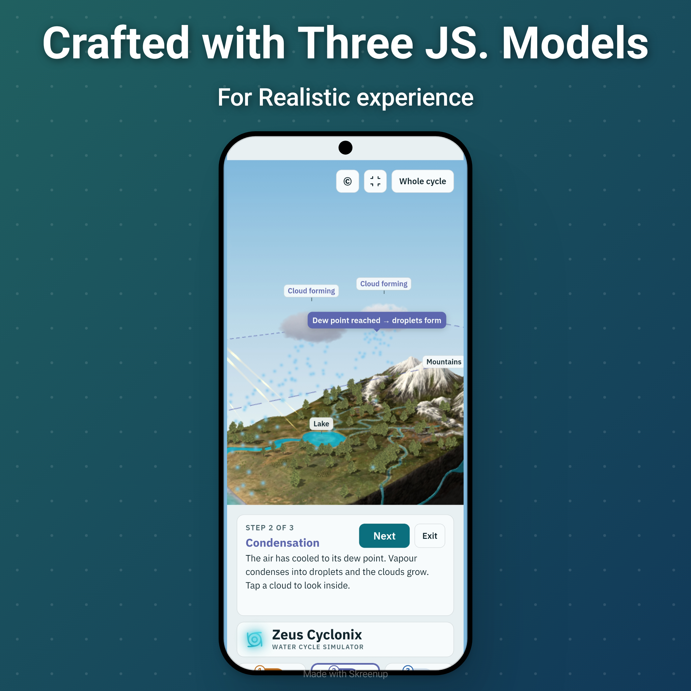

  

<h1 align="center">Zeus Cyclonix</h1>

<em>Interactive 3D Water Cycle Simulator</em>

<a href="https://zeus-cyclonix.stark-kodex.workers.dev/"><strong>Launch the Simulator</strong></a>

  <a href="#about">About</a> ·
  <a href="#screenshots">Screenshots</a> ·
  <a href="#processes">Processes</a> ·
  <a href="#controls">Controls</a> ·
  <a href="#technology">Technology</a> ·
  <a href="#credits">Credits</a> ·
  <a href="#license">License</a>

---

## About

A 3D landscape that shows younger learners how water moves around the Earth. Animated models of the sea, clouds, rain, snow, plants and rivers show where water goes, why clouds form, and why it snows on the peaks but rains on the plains.

Built for classroom smart panels; also runs on laptops and phones.

---

## Screenshots

<table width="100%">
  <tr>
    <td width="50%" align="center">
      
       <b>1 · Water Cycle Simulator</b>
    </td>
    <td width="50%" align="center">
      
       <b>2 · Inside a Cloud</b>
    </td>
  </tr>
  <tr>
    <td width="50%" align="center">
      
       <b>3 · Runoff and Seepage</b>
    </td>
    <td width="50%" align="center">
      
       <b>4 · 3D Landscape</b>
    </td>
  </tr>
</table>

---

## Processes

| Stage | What You See | Explore |
|:--|:--|:--|
| **1 · Evaporation** | The Sun warms the sea and lake; plants transpire; vapour rises as faint mist | Sun's Heat, Humidity and Wind sliders |
| **2 · Condensation** | Rising air cools to its dew point; droplets form and clouds grow | Tap a cloud to look inside |
| **3 · Precipitation** | Rain on the plains, snow on the peaks; runoff to the sea and seepage into groundwater | Data panel: rain or snow, water budget |

**Concepts:** evaporation · transpiration · dew point · condensation · cloud formation · rain and snow · runoff · infiltration · groundwater · conservation of water

<b>Inside a cloud</b>

| Cloud | What You See |
|:--|:--|
| Warm | Vapour molecules collect on a salt crystal, form a droplet, and droplets join into a raindrop; the droplet shows liquid-water structure |
| Freezing | Below 0 °C, molecules lock into a hexagonal ice lattice on a dust grain and grow into a falling snowflake |

<b>Science behind it</b>

| Principle | Used For |
|:--|:--|
| Dalton's law | Evaporation from temperature, humidity and wind |
| Magnus formula | Dew point |
| ~125 m per 1 °C gap to dew point | Cloud base height |
| Rising air cools ~10 °C/km; surrounding air ~6.5 °C/km | Altitude thermometer and snow on the peaks |
| Ice Ih | Hexagonal lattice, O–O 2.76 Å, four hydrogen bonds |
| Bergeron process | Snowflake growth |

Scene heights and the cloud magnifier are not to scale.

---

## Controls

| Control | Function |
|:--|:--|
| Drag · Pinch or scroll | Rotate · Zoom |
| Sun's Heat · Humidity · Wind | 10–45 °C · 20–95% · 0–12 m/s |
| Play / Pause · Speed | Pause (or tap the sky / Space) · ½× to 4× |
| Labels · Sun's Rays · Cycle Arrows | Show or hide each layer |
| Teach Mode | Guided lesson, one process at a time |
| Whole Cycle · Restart · Full Screen · © | View and app options |

---

## Technology

HTML · CSS · JavaScript · Three.js · Cloudflare Pages

<b>Project files</b>

| File | Contents |
|:--|:--|
| `index.html` | Page structure |
| `style.css` | Styling |
| `script.js` | App logic (ES module) |
| `lib/three/` | Three.js and add-ons, bundled |
| `fonts/` | IBM Plex Sans and Mono |
| `models/` | 3D models (GLB) |

---

## Credits

| Contributor | Role |
|:--|:--|
| **Sai Prasad**, M.Sc. Agri. Entomology, ASRB NET | Project Designer |
| Claude Opus 5.5 | Development |
| OpenAI GPT Luna 5.7 | Image Generation |
| Perplexity Sonar 2 | Scientific Reasoning |

<b>3D models</b>

| Asset | Model | Creator | Licence |
|:--|:--|:--|:--|
| Landscape *(animated)* | [Water Cycle (Animated)](https://sketchfab.com/3d-models/water-cycle-animated-203e16058fa94e618829447db71ddba4) | RODX81, shared by Clement Abai | CC BY 4.0 |
| Sun | [Sun with 2K Textures](https://sketchfab.com/3d-models/sun-with-2k-textures-bac9e8f95040484bb86f1deb9bd6fe95) | ayushcodemate | See source |
| Clouds | [Fluffy Cloud](https://sketchfab.com/3d-models/fluffy-cloud-2c887a28840f47cfae6b5dee0d11b842) | Loïc Norgeot | CC BY 4.0 |
| Snow *(animated)* | [Looping Snow 2](https://sketchfab.com/3d-models/looping-snow-2-939d059c7a43424f93c3e8e44e1d5489) | Elin | CC BY 4.0 |
| Raindrops | [drop of water](https://sketchfab.com/3d-models/drop-of-water-dcbdc5e8905449ad95a47720e4d3c57c) | furret | CC BY 4.0 |
| Sea and river *(animated)* | [Water Animation](https://sketchfab.com/3d-models/water-animation-e54ff76bef854b128af8d20cf9c03729) | Artise1 | CC BY 4.0 |
| Water molecule | [H2O Molecule](https://sketchfab.com/3d-models/h2o-molecule-e181944932084b5dbb4d5b625a5e9b10) | Mehdi Mirzaie | CC BY 4.0 |
| Liquid water | [Structure of liquid water](https://sketchfab.com/3d-models/structure-of-liquid-water-bbf17bb125f440d5ab2c71af13e5e6eb) | Justus Mutanen | CC BY 4.0 |
| Maize | [Plant](https://sketchfab.com/3d-models/plant-e94595cf83e74b509fc5b2eac092b4bb) | SomeKevin | CC BY 4.0 |
| Trees, grass tufts | [Low Poly Tree Scene Free](https://sketchfab.com/3d-models/low-poly-tree-scene-free-89daa5e21f0d4f08a59dba0d566e88bd) | Nicholas-3D | CC BY 4.0 |
| Clover | [Clovers - Plants / Foliage](https://sketchfab.com/3d-models/clovers-plants-foliage-d68dc45e329e48e3bc83ecc5448a6c25) | Studio Lab | CC BY 4.0 |
| Ferns, wildflowers | [Plants Asset Set](https://sketchfab.com/3d-models/plants-asset-set-2edf52774f4d4cde8d8c3a19b8dda205) | Em Marshall | CC BY 4.0 |

Models were compressed, resized and recoloured for this simulator; the landscape's magma layer is repainted as rock, and the water molecule uses CPK colours. Original creators retain ownership. [CC BY 4.0](https://creativecommons.org/licenses/by/4.0/)

<b>Libraries and fonts</b>

| Component | Licence |
|:--|:--|
| Three.js | MIT |
| IBM Plex Sans · IBM Plex Mono | SIL Open Font License 1.1 |
| Material Symbols icons (Google) | Apache 2.0 |

---

## Releases

| Release | Title | Date |
|:--|:--|:--|
| RC X | Vegetation | 06 Nov 2026 |
| RC IX | Molecules | — |
| RC VIII | Refinement | 06 Nov 2026 |
| RC VII | Water and Precipitation | — |
| RC VI | 3D Models | — |
| RC V | Sunlight | — |
| RC IV | Science and Teaching | — |
| RC III | Identity | — |
| RC II | Classroom Interface | — |
| RC I | Initial Release | — |

Full history: [CHANGELOG.md](CHANGELOG.md)

---

## License

Source code: **GNU GPL-3.0** (see [LICENSE](LICENSE)). 3D models keep their own licences.

GitHub · Codeberg &nbsp;|&nbsp; Hosted on Cloudflare Pages

