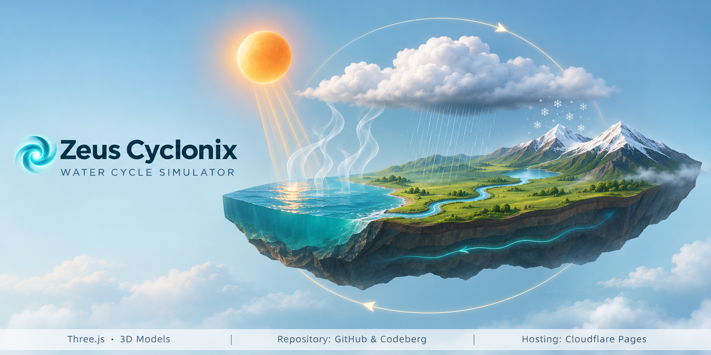

  

<h1 align="center">🌀 Zeus Cyclonix</h1>

<h3 align="center"><em>Interactive 3D Water Cycle Simulator</em></h3>

An interactive 3D simulation of the water cycle: evaporation, condensation, precipitation, runoff and groundwater, driven by real atmospheric physics and built for classroom smart panels.

  <a href="https://zeus-cyclonix.pages.dev"><strong>Enter the Cycle →</strong></a>

---

✨ **Features**

- ☀️ Adjustable sun's rays: stronger sunlight warms the air and speeds up evaporation
- 💧 Evaporation from the sea and lake, plus transpiration from plants
- ☁️ Condensation at the dew point, with a flat cloud base that rises and falls with humidity
- 🔍 Cloud magnifier: water molecules gather on a salt crystal and form a droplet, droplets join, and a raindrop falls
- 🌧️ Rain on the plains and ❄️ snow on the freezing peaks, switching with temperature
- 🌊 Runoff through rivers and groundwater seeping through the rock, back to the sea
- 🌡️ Live readings: dew point, cloud-base height, air temperature with height, and a water budget
- 🎓 Teach mode: evaporation, condensation and precipitation, one step at a time
- 📴 Works offline as a single HTML file

---

🔬 **Science Behind It**

- Evaporation rate from Dalton's law: temperature, humidity and wind
- Dew point from the Magnus formula
- Cloud base ≈ 125 m for every 1 °C gap between air temperature and dew point
- Rising air cools by about 10 °C per km; surrounding air by about 6.5 °C per km

---

🧑🏻‍💻 **Technology**

HTML · CSS · JavaScript · Three.js · Cloudflare Pages

Repository: GitHub & Codeberg

---

🧩 **3D Asset Credits**

Original creators retain ownership of their respective models. Models were compressed, resized and re-coloured for this simulator.

- 🏞️ "Water Cycle (Animated)" by RODX81, shared by Clement Abai · CC BY 4.0 · [Sketchfab](https://sketchfab.com/3d-models/water-cycle-animated-203e16058fa94e618829447db71ddba4)
- ☀️ "Sun with 2K Textures" by ayushcodemate · [Sketchfab](https://sketchfab.com/3d-models/sun-with-2k-textures-bac9e8f95040484bb86f1deb9bd6fe95)
- ☁️ "Fluffy Cloud" by Loïc Norgeot · CC BY 4.0 · [Sketchfab](https://sketchfab.com/3d-models/fluffy-cloud-2c887a28840f47cfae6b5dee0d11b842)
- ❄️ "Looping Snow 2" by Elin · CC BY 4.0 · [Sketchfab](https://sketchfab.com/3d-models/looping-snow-2-939d059c7a43424f93c3e8e44e1d5489)
- 💧 "drop of water" by furret · CC BY 4.0 · [Sketchfab](https://sketchfab.com/3d-models/drop-of-water-dcbdc5e8905449ad95a47720e4d3c57c)
- 🌊 "Water Animation" by Artise1 · CC BY 4.0 · [Sketchfab](https://sketchfab.com/3d-models/water-animation-e54ff76bef854b128af8d20cf9c03729)

Also used: Three.js (MIT) · IBM Plex fonts (SIL Open Font License) · Material Symbols icons by Google (Apache 2.0)

---

👤 **Project Designer**

**Sai Prasad**
Msc. Ag. Entomology, NET

---

🤖 **Development Credits**

- Claude Opus 5.5: AI-assisted development

---

📜 **License**

Original source code is distributed under the GNU GPL-3.0 License (LICENSE). Third-party assets remain subject to their respective licenses.
